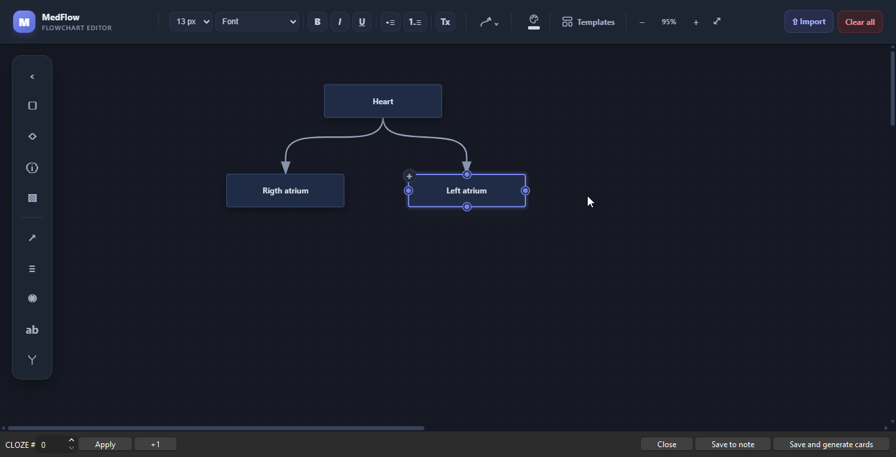
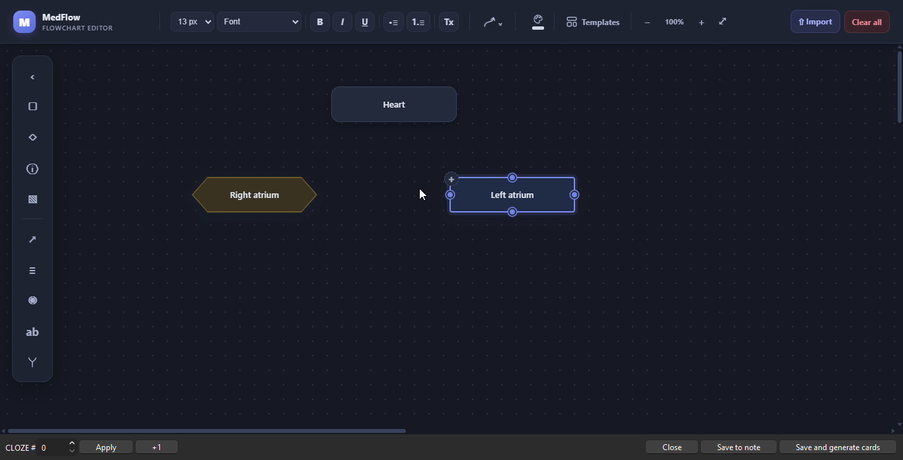
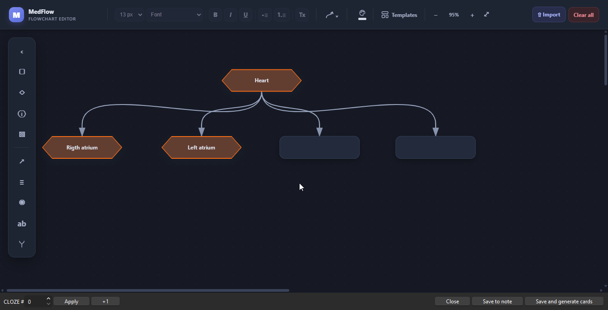
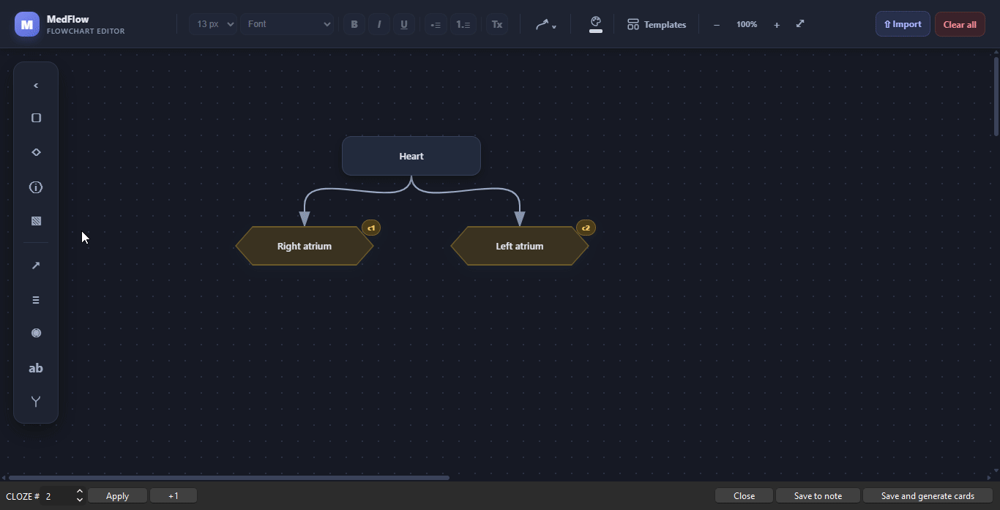
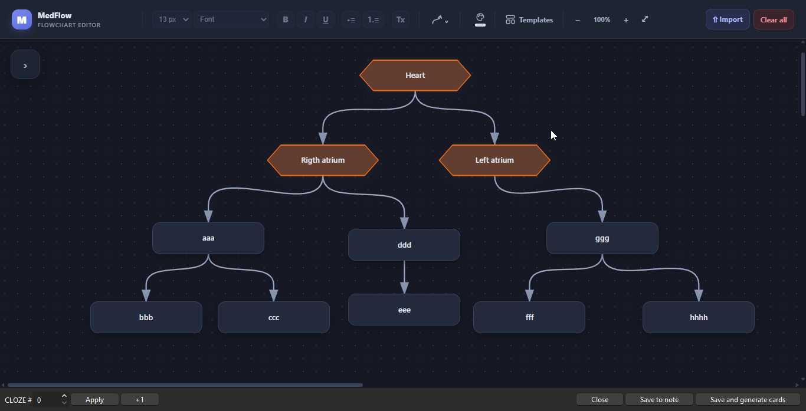
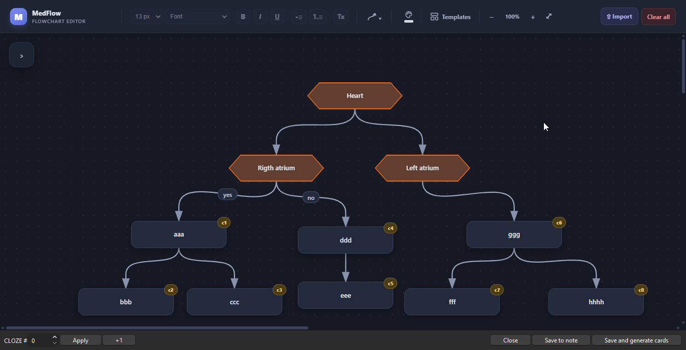
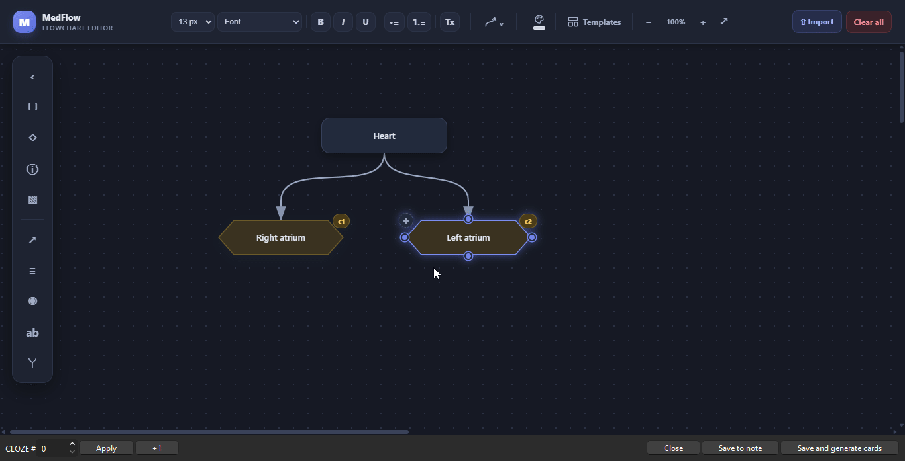
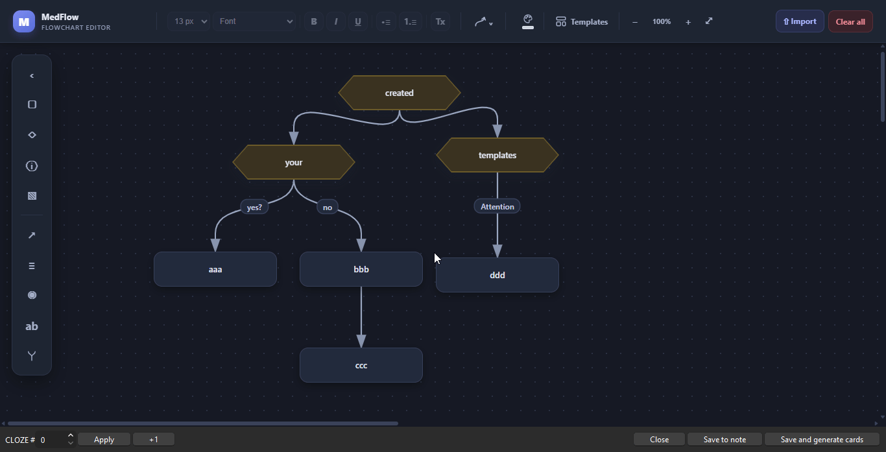

# MEDFlow – Interactive Medical Flowcharts & Cloze Flashcards

**Transform complex medical concepts into interactive visual learning experiences.**

MEDFlow is an Anki add-on that allows you to create interactive medical flowcharts and transform them into Cloze flashcards. It combines visual organization, clinical reasoning, and Anki's spaced repetition system to make studying more active, structured, and engaging.

Inspired by the **ZeestMedical** project, MEDFlow was independently developed to provide an integrated flowchart editor directly within Anki.

## ✦ KEY FEATURES

### 1. 🎨 Interactive Flowchart Editor

Create medical algorithms using three types of elements:

- **Step / Box:** Represents a procedure, clinical finding, stage, or piece of information.
- **Decision:** Represents a clinical decision or branching point, displayed as a diamond.
- **Information:** Highlights additional explanations and important details.

Move, resize, and organize elements freely to create simple or complex clinical pathways.

- Automatic alignment guides.
- Customizable colors, borders, and box appearance.
- Multiple selection and simultaneous editing.
- Change the type of multiple selected boxes at once.
- Undo and redo functionality.
- XMind-inspired keyboard shortcuts.

### 2. 🔗 Connections & Clinical Pathways

Build relationships between elements using interactive connections.

- Connect elements using draggable blue connection points.
- Create relationships between parent and child elements.
- Reconnect arrows by dragging their endpoints.
- Add labels such as Yes, No, Positive, Negative, or clinical criteria.
- Build diagnostic and therapeutic decision trees.
- Customize arrow types and branching structures.

### 3. 🖼️ Image Nodes

Insert images directly into your flowcharts as independent visual elements.

Unlike images added to the Extra field, Image Nodes become part of the flowchart itself.

- Insert images directly into the editing area.
- Paste copied images into the editor.
- Freely resize and reposition images.
- Connect images to other elements using arrows.
- Add captions to images.
- Display images directly in generated Anki cards.
- Captions are automatically hidden when their corresponding images are hidden by Cloze.

### 4. 🃏 Cloze Flashcard Generation

Assign individual Cloze numbers to flowchart elements.

Elements sharing the same Cloze number belong to the same Anki card, while different numbers generate separate cards.

**Features:**
- Assign specific Cloze numbers or automatically increment numbering.
- Display the complete flowchart during review.
- Visually highlight the element being tested.
- Reveal hidden elements by clicking them.
- Review the complete flowchart or use Focus Flow to study specific branches.

Use **Save and Generate Cards** to synchronize your flowchart with Anki and generate the corresponding Cloze cards.

### 5. 🎯 Focus Flow – Progressive Branch-Based Review

Focus Flow allows you to study selected branches progressively instead of displaying the entire algorithm at once.

**How it works:**
- Select boxes belonging to a branch using Shift + Click or Shift + Drag.
- Alternatively, select only the first box to automatically include its connected downstream elements.
- Activate Focus using the target button or `Ctrl + Shift + F`.
- Selected elements receive a visual Focus indicator.
- During review, cards progressively follow the selected pathway, presenting one Cloze at a time.

**During review:**
- The branch starts from its initial element.
- Only the relevant pathway is displayed.
- Arrows guide progression to the next step.
- Unrelated branches remain hidden.
- Elements without Cloze remain visible alongside related elements.
- Cards without Focus settings continue displaying the complete flowchart.

You can switch between the selected branch and the complete flowchart using the eye and target controls.

### 6. 📱 Improved Mobile Review

MEDFlow includes improvements designed to make complex flowcharts more readable on smaller screens, including AnkiMobile.

- Automatic adaptation to screen dimensions.
- Prioritization of the active Cloze element.
- Improved zoom and centering of relevant elements.
- Option to fit the complete flowchart when necessary.
- Adaptation to screen resizing and orientation changes.
- Touch-friendly review controls.

### 7. 💡 Box Hints

Add individual hints to flowchart elements without directly revealing their answers.

- Add hints using the corresponding editor tool.
- Hints appear in green above boxes in the editor.
- During review, a **+** button appears when the corresponding box is hidden by Cloze.
- Click the button to reveal the hint in place of the hidden content.
- Click again to hide it.

Ideal for clues, reminders, and information that supports active recall.

### 8. 📝 Extra – Additional Content

Attach explanations and complementary images to individual elements.

- Add clinical explanations and detailed notes.
- Include observations and additional information.
- Attach images to complementary content.
- Display the corresponding Extra content during card review.

Extra content appears on the back of the corresponding Cloze card.

### 9. 📚 Templates – Ready-to-Use Flowchart Models

Save time by starting with predefined flowchart structures instead of building every diagram from scratch.

- Use predefined templates for medical subjects and clinical algorithms.
- Save your own customized templates.
- Save selected boxes or entire flowcharts as templates.
- Reuse templates across different notes.
- Restore the original templates when necessary.
- Custom templates are stored separately from editor files, helping preserve them during add-on updates.

### 10. ↩️ Undo & Redo

- `Ctrl + Z` – Undo.
- `Ctrl + Y` or `Ctrl + Shift + Z` – Redo.
- Restore previous box and arrow arrangements.
- Maintain up to 200 editing states.

### 11. ✍️ Text Formatting & Visual Customization

- Bold, italic, and underline.
- Different font sizes and font families.
- Bulleted and numbered lists.
- Customizable box colors and borders.
- Different arrow styles and colors.
- Individual formatting for elements and connections.
- Clear formatting options.

### 12. 📤 Import & Export

- Export flowcharts as JSON files.
- Import previously exported diagrams.
- Back up, reuse, and modify existing algorithms.
- Share flowchart structures with other users.

### 13. 🧭 Navigation & Workspace

- Zoom in, zoom out, and fit the entire flowchart to the workspace.
- Pan across the canvas by dragging the background.
- Zoom around the cursor using Ctrl + Mouse Wheel.
- Automatically align elements using visual guides.
- Select multiple elements using Shift + Click or Shift + Drag.
- Collapse the sidebar for a cleaner workspace.
- Dark mode compatibility.
- Preserve zoom level and canvas position between the front and back of cards and between cards during the same review session.

### 14. 🔒 Privacy & Data Storage

- No data is transmitted to external servers. Everything is stored locally on your computer.
- Flowcharts are saved as JSON directly inside Anki notes.
- Images are stored in Anki's media folder and automatically referenced, allowing them to be included in deck exports and shared decks.

## ✦ HOW TO USE MEDFLOW

**Step 1 – Install and Open the Editor**

Install the add-on and restart Anki. The **MedFlow** note type is created automatically. Create a new note using this type and click **Alg** to open the editor.

**Step 2 – Build Your Flowchart**

Add Step, Decision, and Information elements. Double-click an element to edit its text.

**Step 3 – Connect the Elements**

Drag a blue connection point from one element to another to create an arrow. Alternatively, use **Link Mode**.

**Step 4 – Assign Cloze Numbers**

Select an element and enter a number in the CLOZE field. Click **Apply** or **+1** to increment and apply the next number.

**Step 5 – Add Images and Extra Content**

Insert Image Nodes directly into the flowchart or use Extra for complementary notes and images.

**Step 6 – Organize and Customize**

Use multiple selection, change box types, customize colors, add hints, and save frequently used structures as templates.

**Step 7 – Configure Focus Flow (Optional)**

Select a branch using Shift + Click or Shift + Drag and activate Focus.

**Step 8 – Save and Generate Cards**

Use **Save to Card** or **Save and Generate Cards**.

Your cards are now ready for review!

## ✦ KEYBOARD SHORTCUTS

| Shortcut | Action |
|---|---|
| `Ctrl + A` | Add Step / Box |
| `Ctrl + B` | Add Decision |
| `Ctrl + C` | Add Information element |
| `Ctrl + Shift + E` | Edit selected element text |
| `Ctrl + Shift + X` | Open Extra |
| `Ctrl + L` | Toggle Link Mode |
| `Ctrl + Shift + C` | Increment and apply Cloze number |
| `Ctrl + Shift + Alt + C` | Apply current Cloze number |
| `Ctrl + Shift + F` | Activate Focus Flow |
| `Ctrl + S` | Save flowchart to Anki note |
| `Ctrl + Z` | Undo |
| `Ctrl + Y` / `Ctrl + Shift + Z` | Redo |
| `Ctrl + +` / `Ctrl + -` | Zoom in / out |
| `Ctrl + 0` | Reset zoom to 100% |
| `Ctrl + 9` | Fit entire flowchart |
| `Ctrl + Mouse Wheel` | Zoom around cursor |
| `Delete` | Delete selected element or arrow |
| `Ctrl + Shift + Delete` | Clear entire flowchart |
| `Enter / F2` | Edit selected arrow label |
| `Escape` | Cancel Link Mode |

**Text formatting:** `Ctrl + B` Bold · `Ctrl + I` Italic · `Ctrl + U` Underline.

**Additional interactions:**
- Double-click an element to edit its text or an arrow to edit its label.
- Drag elements to reposition them.
- Drag the empty background to pan across the workspace.
- Drag blue connection points to connect elements.
- Use Shift + Click or Shift + Drag to select multiple boxes.
- Use `Ctrl + V` to paste images into the editor or Extra.

*On macOS, use Command (⌘) instead of Ctrl for compatible shortcuts.*

## ✦ WHO IS MEDFLOW FOR?

MEDFlow is designed for medical students, nursing students, healthcare professionals, and anyone who enjoys visual learning and wants to organize complex information using flowcharts.

It is particularly useful for:

- 🧠 Diagnostic algorithms and differential diagnoses.
- 💊 Therapeutic protocols and clinical guidelines.
- 🫀 Pathophysiology and disease progression.
- 🚑 Emergency medicine algorithms.
- ⚖️ Clinical decision-making.
- 📊 Anatomy, histology, pathology, and radiology.
- Any subject that benefits from visual organization.

You do not need to be a healthcare student or professional to use MEDFlow. Anyone who enjoys learning through flowcharts can benefit from it.

## ✦ COMPATIBILITY

- Anki Desktop.
- Windows, macOS, and Linux.
- PyQt5 and PyQt6 support.
- Anki dark mode compatibility.
- Generated cards can be reviewed in compatible Anki clients, including AnkiMobile and AnkiWeb.

## ✦ DEVELOPMENT, AI & ACKNOWLEDGMENTS

MEDFlow was independently developed with inspiration from the **ZeestMedical** project. We acknowledge and appreciate the original developers and contributors for their work.

**Artificial Intelligence (AI) tools** were used throughout development to assist with programming, code generation, debugging, error identification, feature implementation, and user experience improvements.

The project's concept, direction, and development were independently conducted, with AI technologies serving as supporting tools throughout its creation.

---

**MEDFlow – Think Visually. Learn Actively. Remember More. 🧠✨**
